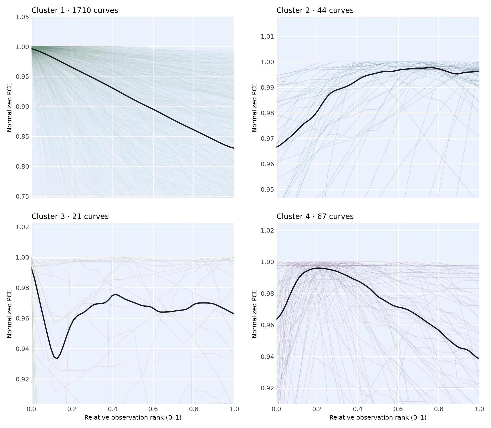

# Perovskite Solar-Cell Degradation Curve Analysis

English · [中文](README_CN.md)

**Research question.** Can unsupervised methods distinguish degradation-curve shapes across perovskite solar-cell studies, or do they mainly recover differences in degradation rate and magnitude?

I curated a literature-derived collection of **2,246 distinct PCE–time curves** and organized its dataset construction, SOM and shape analysis, derivative/DTW comparisons, and method reproductions here. The featured [four-cluster reproduction](reproduction/early-degradation-clusters/README.md) provides fixed inputs, code, figures, and an offline dashboard for **1,842 curves**. The [former standalone repository](https://github.com/ShunHao0626/perovskite-early-degradation-clusters) is archived as a historical entry point.

The four groups contain **1,710 / 44 / 21 / 67 curves**. The figure compares shapes on a relative observation-rank axis; the clustering is exploratory because provisional shape candidates informed input selection. [Explore individual curves](reproduction/early-degradation-clusters/results/dashboard.html) or [read the method](reproduction/early-degradation-clusters/README.md).

## Start here

| Task | Entry point | Scope |
|---|---|---|
| Current 0–200 h shape analysis | [`ML_SOM/target_shape_classification/`](ML_SOM/target_shape_classification/README.md) (README in Chinese) | Input audit, SOM, shape interpretation, source review, and tests |
| Fixed 1,842-curve four-cluster reproduction | [`reproduction/early-degradation-clusters/`](reproduction/early-degradation-clusters/README.md) | Fixed inputs, density-weighted K-means, verification, full results, and an offline dashboard |
| Build the 2,246-curve canonical dataset | [`ML_SOM/canonical_2246_full_dataset_20260925/`](ML_SOM/canonical_2246_full_dataset_20260925/README.md) | Deduplication, provenance, and integrity checks; generated data stay local |
| Reproduce PFD–DTW | [`derivative_clustering/`](derivative_clustering/README.md) | Derivative features, DTW, hierarchical clustering, and tests |
| Reproduce the Hartono PvkSOM workflow | [`thesis/`](thesis/README.md) | Adapted copy of the upstream PvkSOM workflow, run scripts, and a three-way preprocessing comparison on Hartono's own dataset |
| Other derivative DTW experiments | [`DTW/`](DTW/result_derivative_dtw/code/REPRODUCE.md) | Earlier independent experiments and exports |
| Historical SOM, HDBSCAN, and parameter searches | [`by-products/`](by-products/README.md) | Research archive indexed by question |

`environment.yml` describes the earlier PvkSOM environment. For newer projects, use the environment and commands documented in each project directory. The [code map](ML_SOM/target_shape_classification/CODE_MAP.md) shows the dependencies within the current 0–200 h analysis.

## Curve counts used across the project

The sub-projects use different curve sets and processing stages:

| Count | Meaning |
|---:|---|
| 2,250 | Digitized source files from the literature (`ML_SOM/original_curves_2250/`) |
| 2,246 | Canonical curves after removing 4 duplicate aliases of the 2,250 files |
| 2,216 | Canonical curves with a four-pattern record in the integrated delivery: 2,205 by the original automatic rule, 2 by the rule after axis checks in the paper, and 9 from source-figure judgement only |
| 2,207 | The numeric part of the 2,216 records (2,205 + 2), used for strict 0–200 h numeric analysis |
| 2,205 | Curves with the original numeric stage rule, used in the robustness audits |
| 2,208 | Source files that received a four-pattern candidate in the independent 0–200 h rerun (`classify_200h.py`), out of 2,250 |
| 2,152 | Input pool of the shape-only K-means experiments; an earlier label-free quality gate kept 1,897 of them |
| 1,842 | Fixed input of the four-cluster reproduction, selected from the 2,152 with help from provisional shape candidates |
| 2,245 | Hartono et al.'s own high-throughput ageing dataset used in `thesis/`; a separate dataset, not part of the literature collection |

## How the project is organized

The top-level research directories contain curve curation, the broader 0–200 h SOM and morphology study, derivative/DTW comparisons, and historical work. [`reproduction/early-degradation-clusters/`](reproduction/early-degradation-clusters/README.md) contains the complete fixed-input four-cluster package. Run its documented commands from that directory. The two former repositories' Git histories are joined in this repository; the earlier standalone URL is retained for links and provenance.

## Interpretation

The broader question is whether Bridge, Hill, Slope, and Valley patterns form distinct groups without labels. Historical SOM, HDBSCAN, and DTW analyses often divide the heterogeneous literature curves by degradation magnitude and speed. A cluster ID is not a validated pattern label. The fixed 1,842-curve analysis uses density-weighted K-means, **not SOM**; earlier provisional shape candidates influenced its input selection, so its four groups are exploratory.

## Data and publication policy

This repository publishes code, configuration, methods, selected aggregate tables and figures, and the complete fixed-input reproduction package. Local-only material includes `ML_SOM/data_final/`, `ML_SOM/original_curves_2250/`, generated canonical datasets, historical experiment inputs, paper full texts, and upstream per-curve galleries. The reproduction package includes its own 1,842 fixed inputs, results, and source-figure crops. Identifiers such as DOI, figure, and curve ID in other summaries support provenance; they do not imply that every upstream original file is present here.

Unique historical SI text, figures, and per-curve plotting values are retained locally at `ML_SOM/si_1842_supplementary/` and are excluded from this Git repository. Its historical cluster numbering may differ from the reproduction package's display numbering.

## Attribution

The PvkSOM method and reference dataset come from Hartono et al., *Nature Communications* 14, 4869 (2023), [DOI: 10.1038/s41467-023-40585-3](https://doi.org/10.1038/s41467-023-40585-3). See `thesis/LICENSE` for the corresponding code license. Consult and cite the source articles for literature-digitized curves.

Copyright in the source-figure crops included in the reproduction package remains with their original publishers; DOI-based folders identify the source articles.
