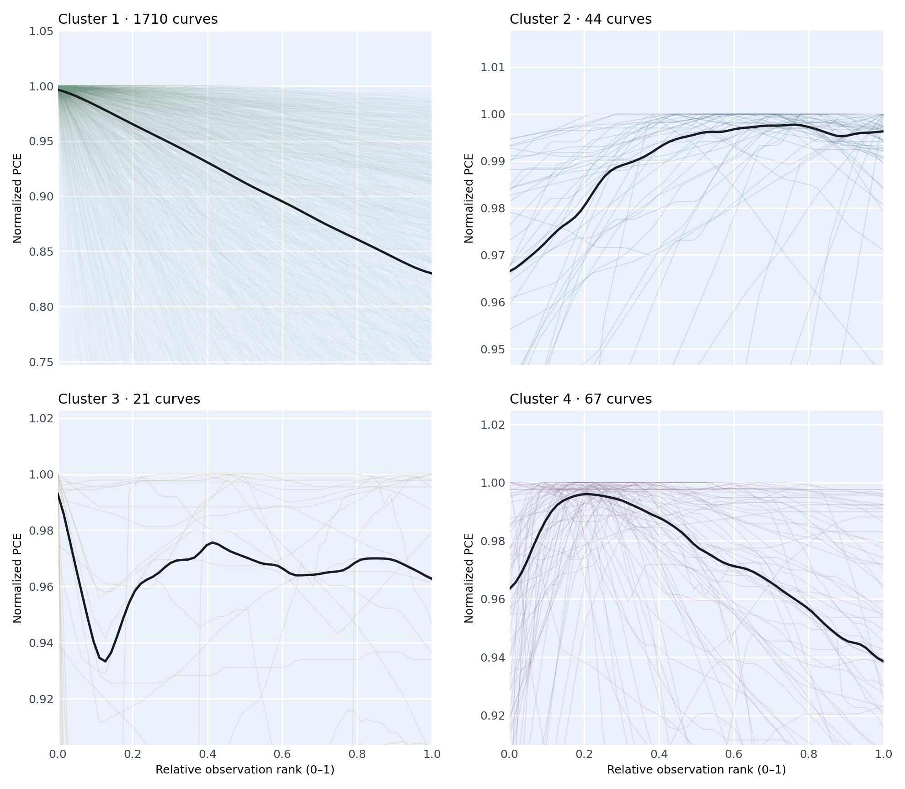

# ML degradation analysis

[English](README.md) · 中文

> **一个项目，一个研究仓库。** 本工作区现已包含[四簇独立复现包](reproduction/early-degradation-clusters/README_CN.md)，并保留数据集构建、方法对照与溯源记录。原[独立仓库](https://github.com/ShunHao0626/perovskite-early-degradation-clusters)仍可作为历史入口访问。

对钙钛矿太阳能电池的 PCE–时间曲线进行整理、无监督聚类与形态分析。本仓库按**当前分析、方法复现、历史实验**组织，并纳入固定 1,842 条曲线的复现包。部分上游原始曲线和第三方论文全文仍保存在本地；复现包已包含固定输入、结果和来源原图裁图。

该固定输入结果属于探索性分析：四簇分别包含 1,710／44／21／67 条曲线，图中的横轴是相对观测序位，而非实际时间。可[浏览单条曲线](reproduction/early-degradation-clusters/results/dashboard.html)，或[阅读方法与限制](reproduction/early-degradation-clusters/README_CN.md)。

## 从哪里开始

| 任务 | 入口 | 内容 |
|---|---|---|
| 当前 0–200 h 四形态分析 | [`ML_SOM/target_shape_classification/README.md`](ML_SOM/target_shape_classification/README.md) | 输入审计、SOM、形态判读、来源复核和测试 |
| 固定 1,842 条曲线的四簇复现 | [`reproduction/early-degradation-clusters/README_CN.md`](reproduction/early-degradation-clusters/README_CN.md) | 固定输入、密度加权 KMeans、核验、完整结果与离线浏览页面 |
| 2,246 条去重曲线的构建 | [`ML_SOM/canonical_2246_full_dataset_20260925/README.md`](ML_SOM/canonical_2246_full_dataset_20260925/README.md) | 构建、来源映射与完整性验证；生成的数据留在本地 |
| PFD–DTW 方法复现 | [`derivative_clustering/README.md`](derivative_clustering/README.md) | 独立的导数特征、DTW、层次聚类及单元测试 |
| Hartono 等人的 PvkSOM 复现 | [`thesis/README.md`](thesis/README.md) | 上游 PvkSOM 工作流的改编副本、运行脚本，以及在 Hartono 自有数据集上的三种预处理对比 |
| 其他导数 DTW 实验 | [`DTW/result_derivative_dtw/code/REPRODUCE.md`](DTW/result_derivative_dtw/code/REPRODUCE.md) | 早期独立实验和结果导出 |
| 历史 SOM、HDBSCAN 和参数探索 | [`by-products/README_CN.md`](by-products/README_CN.md) | 按研究问题索引既有实验，不参与当前入口 |

`environment.yml` 是早期 PvkSOM 实验环境。当前子项目优先使用各自的 `requirements.txt`、配置和 README。脚本通常从其子项目目录运行；需要先放入相应的本地数据，再按该目录说明执行。

当前 0–200 h 分析的模块依赖和数据流另见 [代码导航](ML_SOM/target_shape_classification/CODE_MAP_CN.md)。

## 项目中出现的曲线数量

各子项目文档中出现了多个曲线数量，它们对应不同的处理阶段，并非结果相互矛盾：

| 数量 | 含义 |
|---:|---|
| 2,250 | 从文献数字化得到的源文件（`ML_SOM/original_curves_2250/`） |
| 2,246 | 去除 2,250 个文件中 4 个重复别名后的规范曲线 |
| 2,216 | 整合交付中带四形态记录的规范曲线：2,205 条来自原自动规则，2 条为论文核轴后的自动规则，9 条仅来自原图人工判读 |
| 2,207 | 2,216 条中有数值数据的部分（2,205 + 2），用于严格的 0–200 h 数值分析 |
| 2,205 | 适用原数值阶段规则的曲线，用于稳健性审计 |
| 2,208 | 独立 0–200 h 重新分类（`classify_200h.py`）中，2,250 个源文件里获得四形态候选的文件数 |
| 2,152 | 纯形状 K-means 实验的输入池；较早一轮无标签质量门槛保留其中 1,897 条 |
| 1,842 | 四簇复现的固定输入，在借助暂定形状候选的情况下从 2,152 条中筛出 |
| 2,245 | `thesis/` 使用的 Hartono 等人自有高通量老化数据集，与文献曲线集无关 |

## 项目目录分工

顶层研究目录保留上游曲线库构建、0–200 h SOM 与形态研究、导数/DTW 对照、PvkSOM 复现，以及可追溯的历史探索。[`reproduction/early-degradation-clusters/`](reproduction/early-degradation-clusters/README_CN.md) 则包含固定 **1,842 条输入**上的完整四簇复现包；请在该目录运行其 README 中的命令。两个原仓库的 Git 历史已在本仓库汇合，原独立仓库链接保留供溯源。

## 研究边界

项目主要检验 Bridge、Hill、Slope、Valley 四种目标曲线形态在无标签聚类中是否自然分开。历史 SOM、HDBSCAN 与 DTW 实验表明，真实文献曲线的簇更常按衰减幅度和速度分开。目标形态可作为逐曲线判读线索，但不能把簇号当作已验证的四类标签。固定 1,842 条输入的四簇实验使用过旧的候选筛选，因此属于探索性分析；其方法是密度加权 KMeans，不是 SOM。具体限制见[复现包的 README](reproduction/early-degradation-clusters/README_CN.md)。

## 数据与发布范围

Git 中保留代码、配置、方法文档、必要的汇总表与汇总图，以及完整的固定输入复现包。以下上游材料保存在工作机或由使用者从原始来源获取：

- `ML_SOM/data_final/`、`ML_SOM/original_curves_2250/`、`ML_SOM/canonical_2246_full_dataset_20260925/{dataset,derived}/` 等原始或派生曲线；
- `by-products/` 下历史实验使用的曲线、矩阵、模型和论文全文；
- 本地文献库、原图、PDF、逐曲线图库及压缩包。

固定 1,842 条输入、结果和来源原图裁图现已纳入 `reproduction/early-degradation-clusters/`。仓库中的其他索引、配置和结果可能包含 DOI、图号、曲线 ID 或原工作机路径，用于溯源，不代表相应上游原始文件已公开。其他子项目的完整复现需要按各自 README 准备数据。

原 SI 中独有的文稿、图表和逐曲线绘图数值暂存于本地 `ML_SOM/si_1842_supplementary/`，不加入本 Git 仓库；其中的历史簇编号应与复现包的展示编号区分。

## 来源

PvkSOM 方法及参考数据：Hartono 等，*Nature Communications* 14, 4869 (2023)，[DOI: 10.1038/s41467-023-40585-3](https://doi.org/10.1038/s41467-023-40585-3)。`thesis/LICENSE` 为相应代码许可。文献数字化曲线应回查并引用各原始论文。

复现包中的论文原图裁图版权仍归原出版方所有；按 DOI 命名的目录用于识别来源论文。
