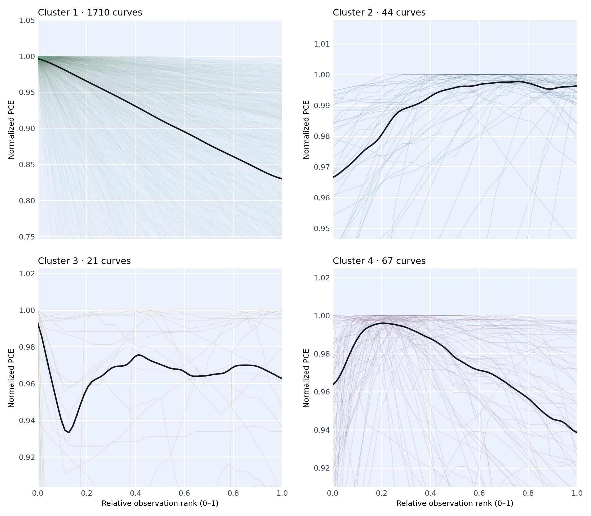

# Perovskite early degradation: four curve patterns

[中文](README_CN.md) · [Detailed method (中文)](docs/WORKFLOW_CN.md)

> **Self-contained reproduction package.** This directory is part of [ml-degradation-analysis](../../README.md), which also contains dataset construction (2,250 source files → 2,246 canonical curves), the broader 0–200 h SOM/morphology analysis, PFD–DTW derivative clustering, and the Hartono PvkSOM reproduction. The fixed 1,842-curve input used here is a subset of that canonical collection. The former [standalone repository](https://github.com/ShunHao0626/perovskite-early-degradation-clusters) remains available for historical links.

A reproducible analysis of **1,842 literature-mined perovskite solar-cell stability curves** over the **0–200 h** early period. The included results group curve shapes into four exploratory clusters, named for display as **Slope (Cluster 1), Bridge (Cluster 2), Valley (Cluster 3), and Hill (Cluster 4)**.

The clusters are highly unbalanced: Slope contains **1,710 of 1,842 curves (93 %)**, while Bridge, Valley, and Hill together contain 132 curves (44 / 21 / 67).

## Core result: zoomed-in view of the four clusters

<p align="center"><a href="results/figures/Supplementary_Fig_S1_zoom.png"></a></p>

The pale lines are individual curves; black lines show smoothed median trends for display. Each panel has its own zoomed vertical scale, and the horizontal axis is **relative observation rank**, not elapsed hours. [Open the vector figure](results/figures/Supplementary_Fig_S1_zoom.svg) or [browse individual curves](results/dashboard.html).

> **Method:** Each curve's precomputed 64-point shape on a relative-rank axis (`data/shape_inputs.npz`) is shifted to start at 0, divided by its own amplitude (max − min, floor 0.01), and smoothed with a Gaussian filter (σ = 1.5 points). A degree-5 Chebyshev polynomial is fitted on the rank axis from −1 to 1, and the five non-constant coefficients (orders 1–5) form the shape features. The features are scaled with `RobustScaler` (10th–90th percentile range) and clustered with K-means into four groups, using sample weights proportional to the distance to the 31st nearest neighbour (clipped to 0.2–10), so curves in sparse regions of feature space receive more weight. The code does not implement a self-organizing map (SOM). Class names are not used in the fit, but the fixed input set was curated earlier with provisional shape candidates and the feature and model choices were informed by the target shapes, so the four groups are exploratory rather than independently validated classes.

## Repository layout

| Folder | Contents |
| --- | --- |
| [`code/`](code/) | Analysis, verification, plotting, dashboard builder, pinned dependencies, and configuration |
| [`data/`](data/) | Fixed input index, 0–200 h observations, 64-point shapes, extracted CSVs, and crops of the source figures from the original articles |
| [`results/`](results/) | Included four-cluster output, figures, source copies, and offline [dashboard](results/dashboard.html) |
| [`docs/`](docs/) | Detailed method and interpretation |

## Reproduce the results

Use **Python 3.9**. From this package directory (`reproduction/early-degradation-clusters/`) on macOS/Linux:

```bash
python3 -m venv .venv
.venv/bin/python -m pip install -r code/requirements.txt
.venv/bin/python code/verify.py
OPENBLAS_NUM_THREADS=1 OMP_NUM_THREADS=1 .venv/bin/python code/run.py
.venv/bin/python code/verify.py --check-results
```

The run writes to `results/` and replaces the generated cluster folders. Expected cluster sizes are **1,710 / 44 / 21 / 67**. Open `results/dashboard.html` locally to browse all curves and source figures. Parameters are in [`code/config.json`](code/config.json); the full workflow is in [`docs/WORKFLOW_CN.md`](docs/WORKFLOW_CN.md).

**Scope:** This package reproduces clustering from a fixed set of already extracted curves. It does not repeat paper-figure digitization or selection from the larger candidate collection; those steps are documented in the [parent workspace](../../README.md). Clustering uses observation rank, not elapsed hours, as its shape axis.

**Source figures:** `data/raw_csv/` and the per-cluster copies under `results/cluster_*/` include crops of the published figures from which each curve was digitized, so that every curve can be checked against its source. Copyright in these figures remains with the original publishers; each file is identified by the article DOI in its folder name.
